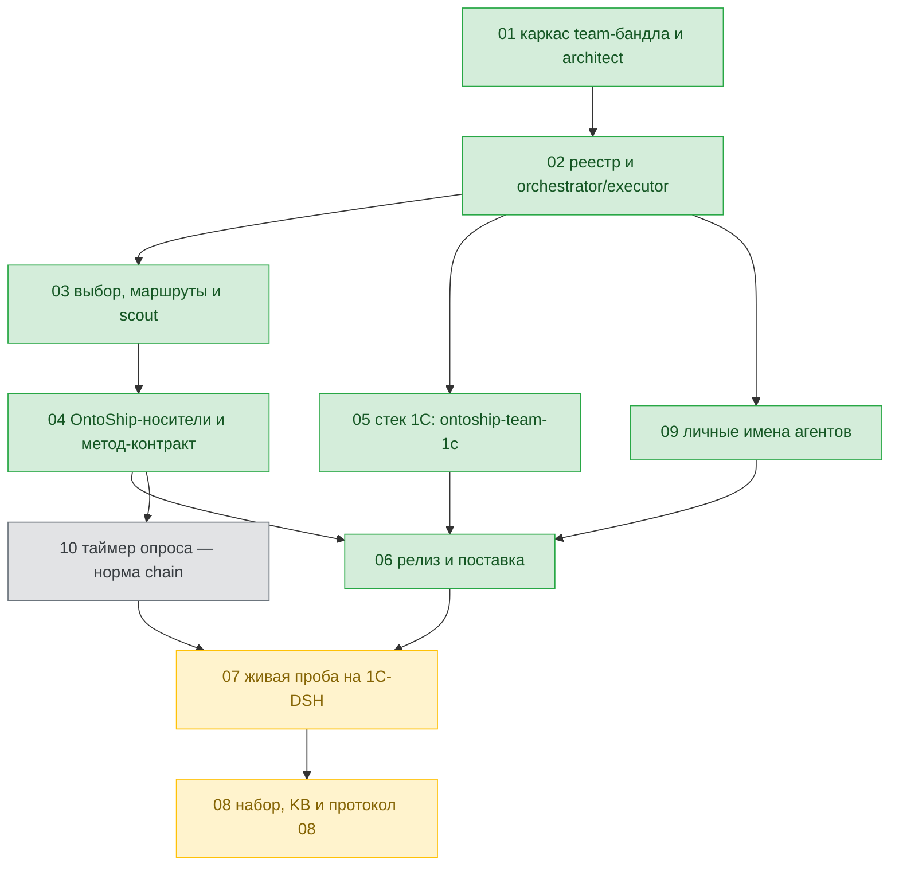

# DAG юнита team-profiles

Производный вид: граф зависимостей, вычисленный оркестратором из
блокирующих рёбер тикетов `tickets/team-profiles/`. Источник истины —
тикеты; файл перегенерируется при смене статусов, отдельно не ведётся.
Рёбра показаны в транзитивной редукции (связи, задающие порядок
исполнения); полные блокеры каждого тикета — в его шапке и в Kanban.
Цвета статусов — лексика Temporal: Completed — зелёный, Running —
синий, Pending — серый, ожидание блокеров — янтарный.

Порядок исполнения последовательный (параллельное исполнение веток
отложено решением оператора 2026-11-11): после закрытия 03 готовы 04 и
05, они идут в порядке публикации — 04, затем 05; тикет 09 (принят
ask 2026-11-13, блокер 02) исполняется после 05 и до релиза 06; тикет
10 (принят ask 2026-11-13, блокер 04) — после 06 и до живой пробы 07.

Обновлено: 2026-11-14, тикет 06 принят автоприёмкой (тег v0.1.0, пин
c58afe1); ready-frontier: 10; последовательный порядок — 10, 07, 08.
Цепочка в авторежиме.