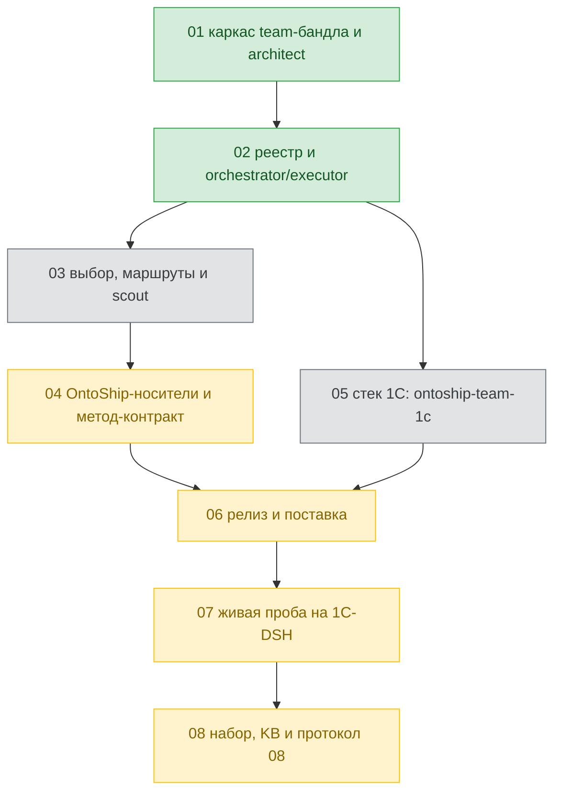

# DAG юнита team-profiles

Производный вид: граф зависимостей, вычисленный оркестратором из
блокирующих рёбер тикетов `tickets/team-profiles/`. Источник истины —
тикеты; файл перегенерируется при смене статусов, отдельно не ведётся.
Рёбра показаны в транзитивной редукции (связи, задающие порядок
исполнения); полные блокеры каждого тикета — в его шапке и в Kanban.
Цвета статусов — лексика Temporal: Completed — зелёный, Running —
синий, Pending — серый, ожидание блокеров — янтарный.

Порядок исполнения последовательный (параллельное исполнение веток
отложено решением оператора 2026-11-11): после закрытия 03 готовы 04 и
05, они идут в порядке публикации — 04, затем 05.

Обновлено: 2026-11-13, тикеты 01–02 приняты автоприёмкой (merge
`57e633f`, `622d0bd`); ready-frontier: 03 и 05, порядок по публикации —
03, 04, 05.