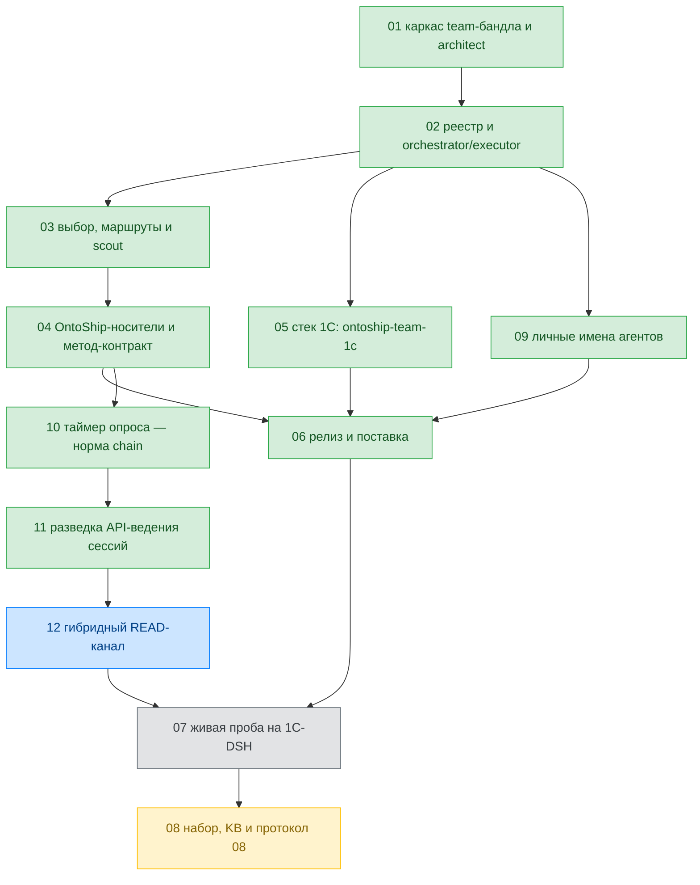

# DAG юнита team-profiles

Производный вид: граф зависимостей, вычисленный оркестратором из
блокирующих рёбер тикетов `tickets/team-profiles/`. Источник истины —
тикеты; файл перегенерируется при смене статусов, отдельно не ведётся.
Рёбра показаны в транзитивной редукции (связи, задающие порядок
исполнения); полные блокеры каждого тикета — в его шапке и в Kanban.
Цвета статусов — лексика Temporal: Completed — зелёный, Running —
синий, Pending — серый, ожидание блокеров — янтарный.

Порядок исполнения последовательный (параллельное исполнение веток
отложено решением оператора 2026-11-11). Тикет 12 (принят ask
2026-11-15, блокер 11, блокирует 07) — гибридный READ-канал (решение 21),
встал между 11 и 07; 07 ждёт 12.

Обновлено: 2026-11-15, тикет 12 принят ask и в работе (исполнитель-8);
ready-frontier: нет; последовательный порядок — 12, 07, 08.
