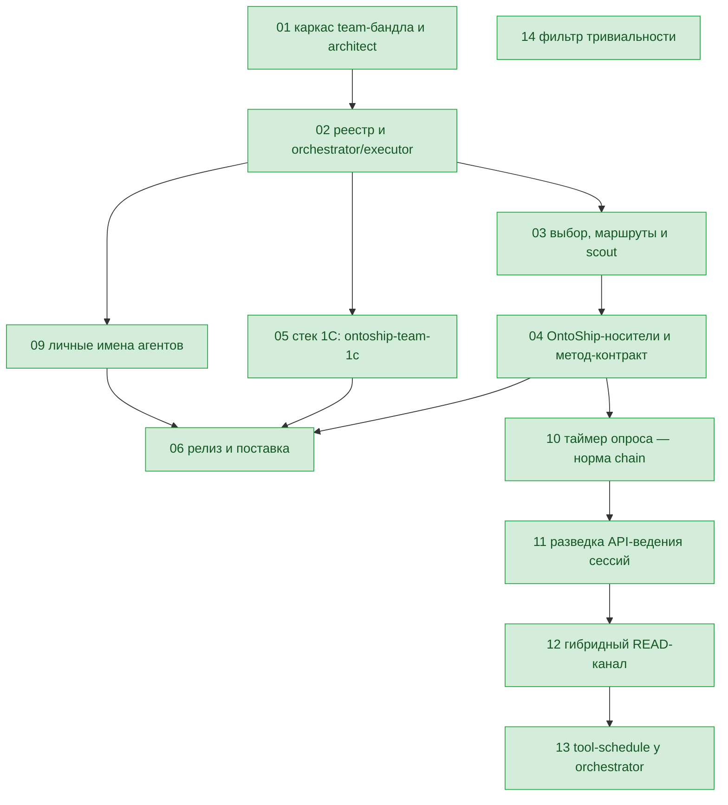

# DAG юнита team-profiles (ядро: закрытые тикеты)

Производный вид: граф зависимостей, вычисленный из блокирующих рёбер
тикетов `tickets/team-profiles/`. Источник истины — тикеты; файл
перегенерируется при смене статусов, отдельно не ведётся. Рёбра
показаны в транзитивной редукции (связи, задающие порядок исполнения);
полные блокеры каждого тикета — в его шапке и в Kanban. Цвета
статусов — лексика Temporal: Completed — зелёный, Running — синий,
Pending — серый, ожидание блокеров — янтарный.

Перенос 2026-11-17 (core-team-boundaries 05, триаж G22): открытые
тикеты 07/08 и спека переехали в ontoship-team; вид ядра
перегенерирован без 07/08 и несёт только закрытые тикеты. Полный граф
юнита и виды открытых тикетов — в team: носитель
`ontoship-team/tickets/team-profiles/` (dag.md, kanban.md).

Все тикеты вида закрыты автоприёмкой (2026-11-13/16). Ready-frontier
ядра пуст: открытая работа юнита (07, 08) — в team.

Обновлено: 2026-11-17, перенос 07/08 в team (core-team-boundaries 05).
